# ClimaAlerta 🌩️

**Alertas climáticos para proteger você e sua comunidade.**

Aplicativo Android desenvolvido em **Kotlin + Jetpack Compose** para a **Global Solution 2026.2 (FIAP)**, disciplina de Android, dentro do tema **CitizenTech**.

---

## 📌 Descrição da solução

Eventos climáticos extremos (chuvas intensas, enchentes, ondas de calor, tempestades, ventos fortes e tempo seco) afetam milhões de brasileiros todos os anos. A previsão do tempo existe e é aberta, mas costuma chegar ao cidadão em formato técnico (milímetros, km/h, códigos meteorológicos), o que dificulta entender **o risco real** e **o que fazer**.

O **ClimaAlerta** transforma dados meteorológicos abertos em **alertas simples e acionáveis**:

- consome a previsão de 7 dias de uma **API REST pública (Open-Meteo)**;
- aplica **regras de risco inspiradas nos avisos do INMET** (*Perigo potencial*, *Perigo* e *Grande perigo*);
- mostra, para cada alerta, **como agir** (orientações da Defesa Civil) e **telefones de emergência** com um toque;
- permite **buscar qualquer cidade do Brasil**, **favoritar** as cidades que importam (onde mora, trabalha ou tem família) e acompanhar tudo em um **painel de riscos**.

Público-alvo: moradores de áreas de risco, famílias com idosos e crianças, pequenos produtores rurais e agentes comunitários que precisam se antecipar a eventos climáticos.

## 🌎 Tema da Global Solution

**CitizenTech: tecnologia criada a partir das necessidades reais das pessoas.** O ClimaAlerta segue a sugestão do desafio de *"sistemas de previsão de enchentes, deslizamentos, incêndios e ondas de calor com alertas direcionados à população"*.

Objetivos de Desenvolvimento Sustentável (ONU) relacionados:

| ODS | Contribuição |
|-----|--------------|
| **ODS 3** – Saúde e bem-estar | Orientações contra insolação, desidratação e efeitos do tempo seco/frio. |
| **ODS 11** – Cidades e comunidades sustentáveis | Informação de risco acessível para reduzir danos de desastres em áreas urbanas. |
| **ODS 13** – Ação contra a mudança global do clima | Aumenta a capacidade de adaptação da população a eventos extremos. |

---

## ✅ Requisitos da avaliação × implementação

| # | Requisito | Onde está no projeto |
|---|-----------|----------------------|
| 1 | **Splash** com logo, transição automática e verificação em SharedPreferences | `ui/screens/splash` – `SplashViewModel` lê `UserPreferences.hasSeenOnboarding()` e decide entre Introdução e Painel. |
| 2 | **Onboarding** com imagem, título, descrição, botões Voltar/Avançar e opção "não mostrar novamente" salva em SharedPreferences | `ui/screens/onboarding` – `HorizontalPager` com 3 páginas, `Checkbox` "Não mostrar a introdução novamente"; `OnboardingViewModel.completeOnboarding()` grava a escolha. |
| 3 | **Navigation Compose** com no mínimo 4 telas principais | `ui/navigation` – rotas tipadas (`@Serializable`), `NavHost` e barra inferior. Telas principais: **Painel, Buscar, Alertas, Orientações e Detalhe da cidade** (5, sem contar Splash e Introdução). |
| 4 | **WebService com Retrofit** tratando estado inicial, carregamento, sucesso e erro | `data/remote` (Retrofit + Gson + OkHttp) e `ui/model/UiState.kt` (`Idle`, `Loading`, `Success`, `Error`). |
| 5 | **Componentes Compose**: Column, Row, Card, LazyColumn, Scaffold, TopAppBar, botões, ícones e imagens | Usados em todas as telas; `Image` com `painterResource` na Splash, Introdução e Orientações. |
| 6 | **Interação**: clique para detalhe, filtro/busca, botões de ação, favoritar, atualização e alteração de estado visual | Clique no card abre o detalhe; busca de cidades e filtro por texto/risco; favoritar com estrela animada; *pull-to-refresh* e botão atualizar; Snackbar "Desfazer"; cards que expandem; botão "Ligar". |
| 7 | **Organização e boas práticas** | Arquitetura MVVM + Repository, injeção de dependências manual, regra de negócio em *use case* testado, composables reutilizáveis em `ui/components`, textos em `strings.xml`. |

---

## 🧭 Fluxo de telas

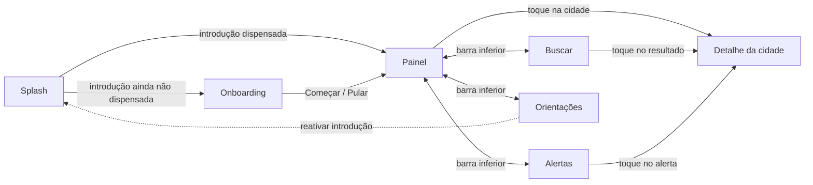

1. **Splash**: exibe o logo por 2 s e consulta o SharedPreferences.
2. **Onboarding**: 3 páginas explicando a proposta, com Voltar/Avançar, Pular e a opção *"Não mostrar a introdução novamente"*.
3. **Painel**: cidades monitoradas (favoritas) com tempo atual, máxima/mínima e nível de risco; resumo geral, busca por texto e filtro por nível de risco.
4. **Buscar**: pesquisa cidades brasileiras na API (com *debounce*), favorita e abre o detalhe.
5. **Detalhe da cidade**: condições atuais, situação de risco, alertas ativos com "Como agir" e previsão de 7 dias.
6. **Alertas**: central com os alertas de todas as cidades, contadores por nível e filtro por tipo de evento.
7. **Orientações**: telefones de emergência (199, 193, 192, 190), dicas por tipo de evento, preferência da introdução e informações do app.

## 📱 Prints das telas

| Splash | Introdução (1/3) | Introdução (2/3) | Introdução (3/3) |
|:---:|:---:|:---:|:---:|
| 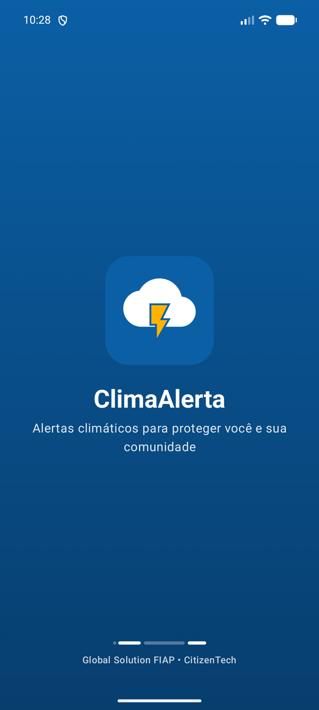 | 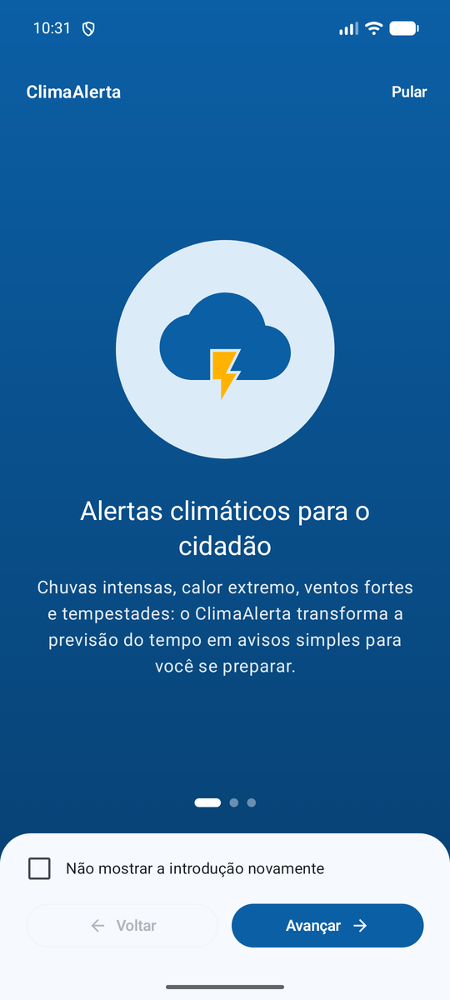 | 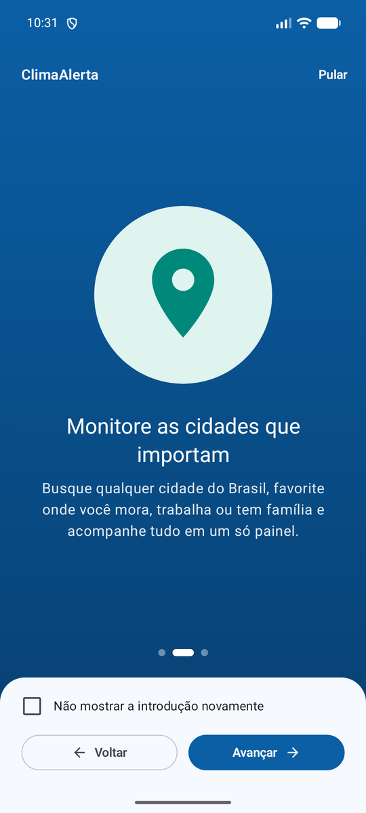 | 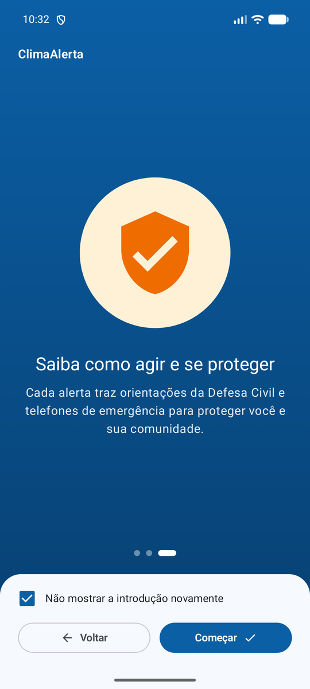 |

| Painel – carregando | Painel – sucesso | Painel – erro | Buscar – estado inicial |
|:---:|:---:|:---:|:---:|
| 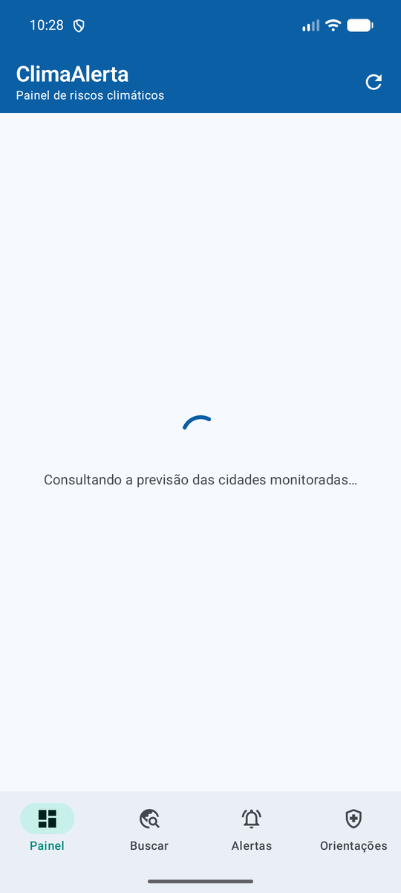 | 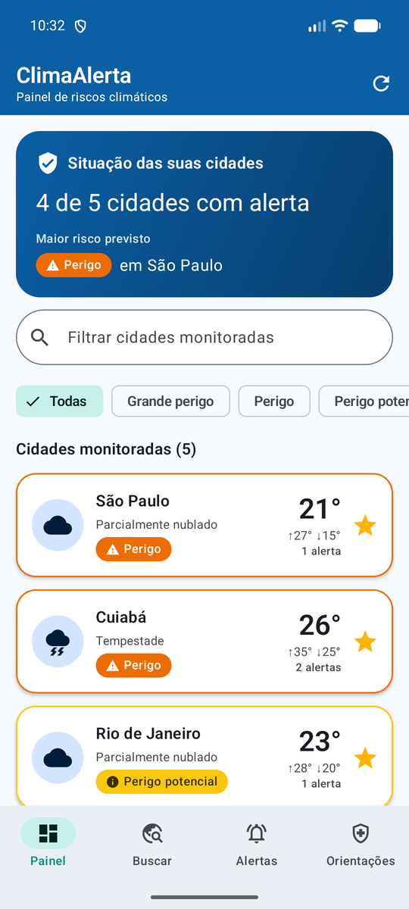 | 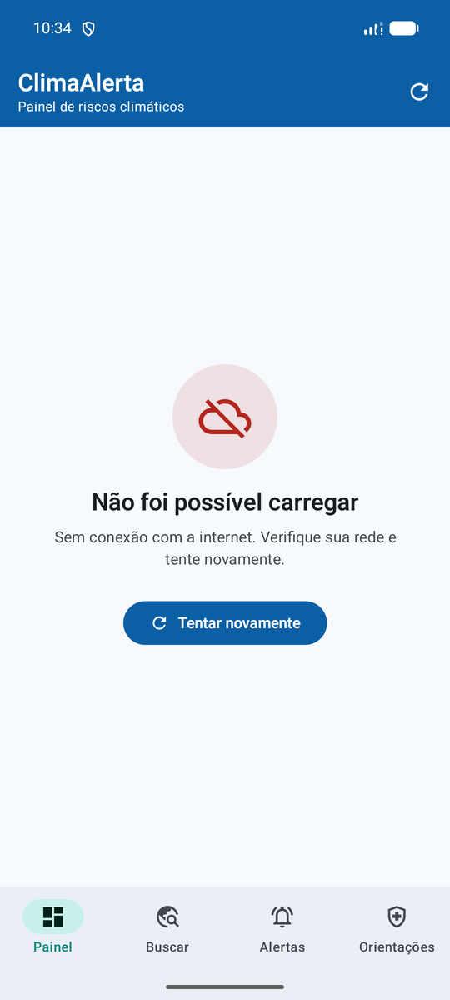 | 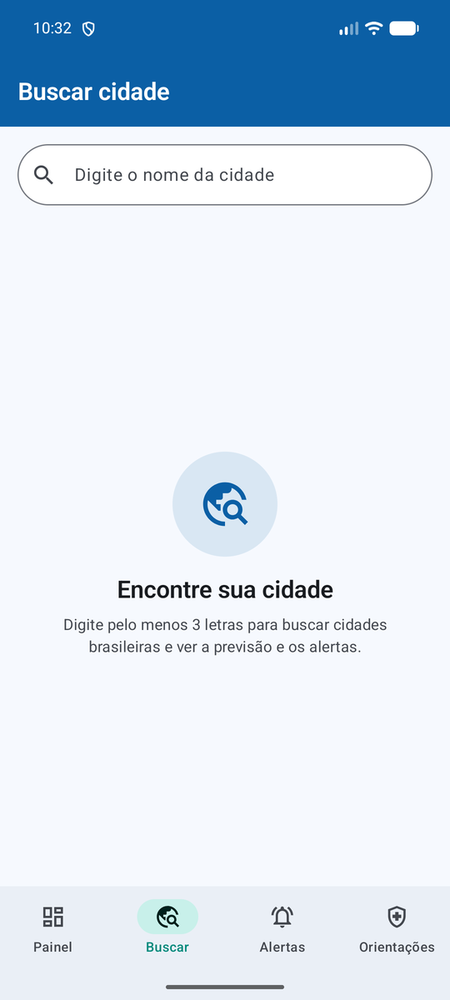 |

| Buscar – resultados | Detalhe da cidade | Detalhe – "Como agir" | Alertas |
|:---:|:---:|:---:|:---:|
| 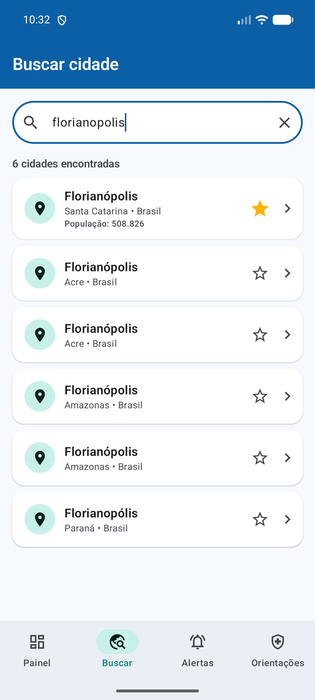 | 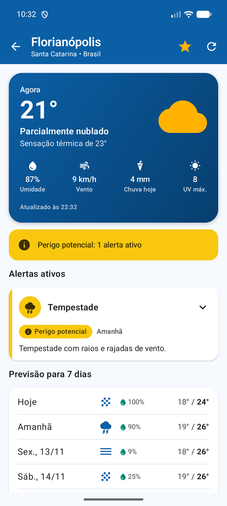 | 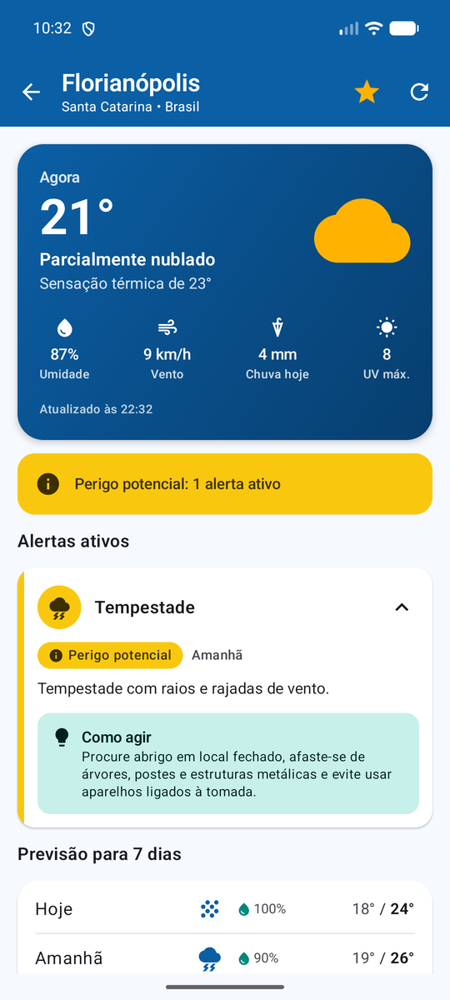 | 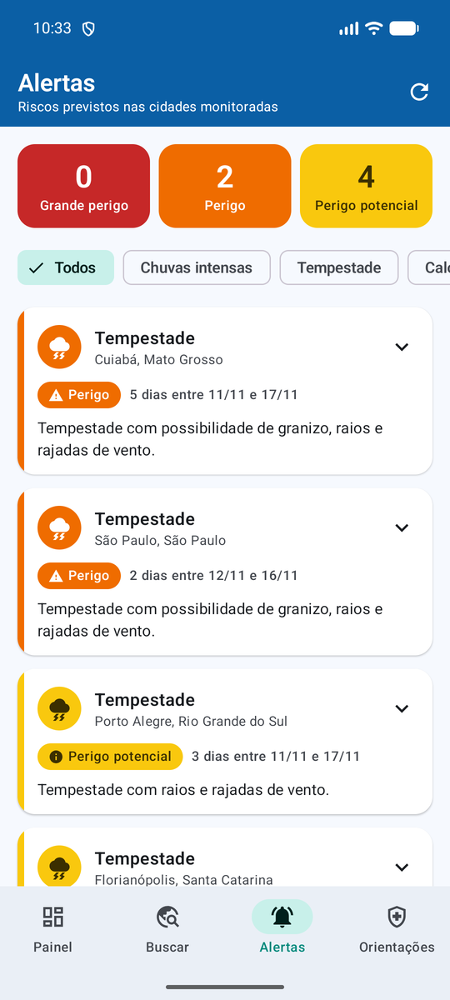 |

| Alertas – filtro | Orientações | Orientações – dicas | Orientações – preferências |
|:---:|:---:|:---:|:---:|
| 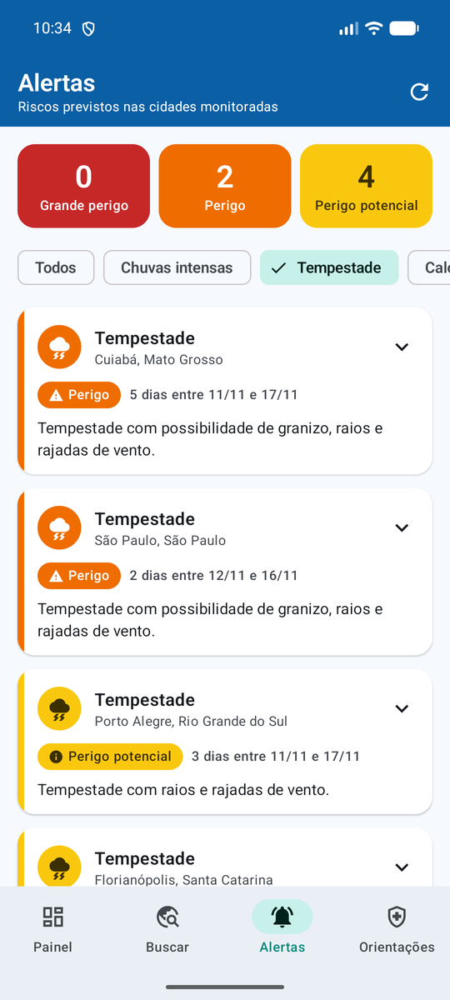 | 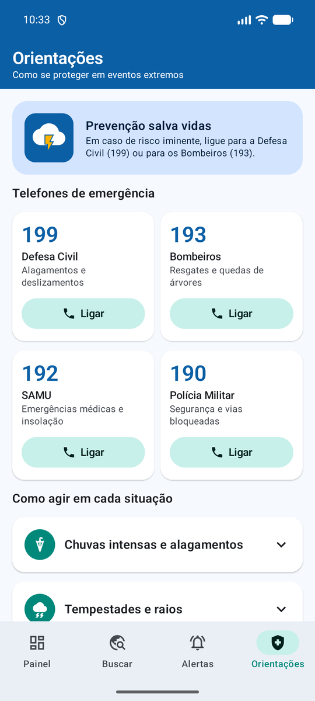 | 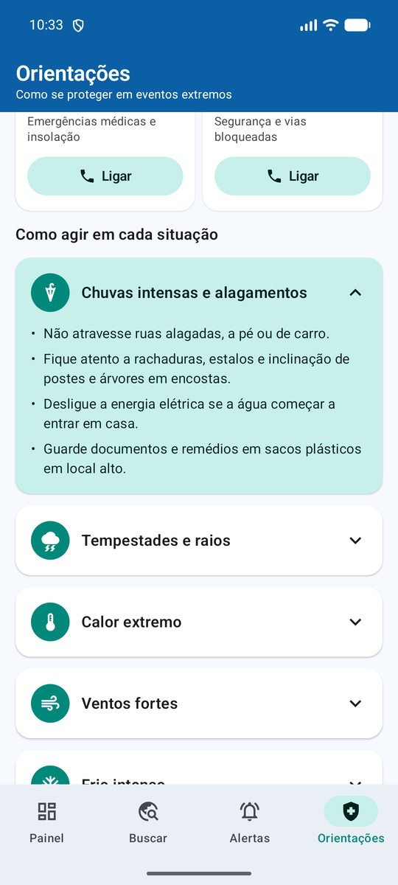 | 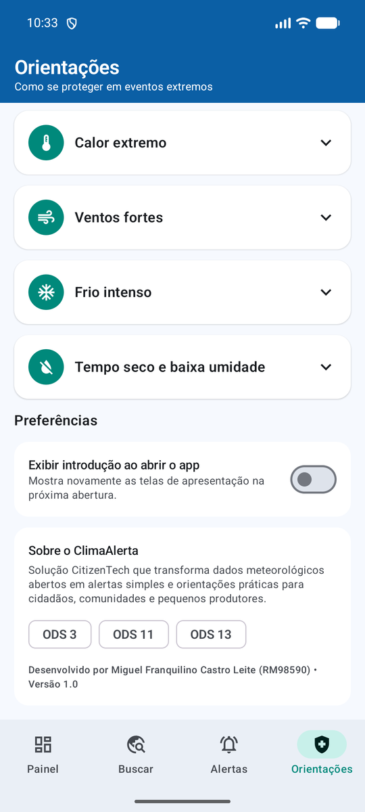 |

---

## 🌐 API utilizada

**[Open-Meteo](https://open-meteo.com/)**: API REST pública, gratuita, **sem necessidade de chave**, com dados de modelos meteorológicos globais e nacionais.

| Uso no app | Método e endpoint | Principais parâmetros |
|------------|-------------------|-----------------------|
| Previsão atual + 7 dias | `GET https://api.open-meteo.com/v1/forecast` | `latitude`, `longitude`, `current` (temperatura, sensação, umidade, chuva, vento, código do tempo), `daily` (máx/mín, chuva acumulada, probabilidade de chuva, vento máximo, índice UV, umidade mínima), `timezone=auto`, `forecast_days=7` |
| Busca de cidades | `GET https://geocoding-api.open-meteo.com/v1/search` | `name`, `count=20`, `language=pt`, `countryCode=BR` |

Exemplo:
```
https://api.open-meteo.com/v1/forecast?latitude=-23.5475&longitude=-46.63611&current=temperature_2m,weather_code&daily=temperature_2m_max,precipitation_sum&timezone=auto&forecast_days=7
```

### Regras de alerta (regra de negócio do app)

Implementadas em `domain/usecase/EvaluateClimateAlertsUseCase.kt` e cobertas por testes unitários. Os limiares foram simplificados a partir dos critérios de aviso do INMET:

| Evento | Perigo potencial | Perigo | Grande perigo |
|--------|:---:|:---:|:---:|
| Chuvas intensas (acumulado no dia) | ≥ 20 mm | ≥ 50 mm | ≥ 100 mm |
| Tempestade (código WMO) | 95 | 96/99 (granizo) | – |
| Calor extremo (máxima) | ≥ 35 °C | ≥ 38 °C | ≥ 40 °C |
| Frio intenso (mínima) | ≤ 5 °C | ≤ 2 °C | ≤ -2 °C |
| Ventos fortes | ≥ 40 km/h | ≥ 60 km/h | ≥ 100 km/h |
| Radiação UV | índice ≥ 11 | – | – |
| Baixa umidade (mínima) | ≤ 30 % | ≤ 20 % | ≤ 12 % |

Quando o mesmo evento aparece em vários dias, ele é **consolidado** em um único alerta com o pior nível, o valor de pico e o período (ex.: *"3 dias entre 11/11 e 17/11"*).

> ⚠️ Os níveis de risco são calculados pelo app e **não substituem os comunicados oficiais** da Defesa Civil e do INMET.

---

## 🏗️ Arquitetura

O projeto segue **MVVM + Repository**, com separação em três camadas e fluxo de dados unidirecional:

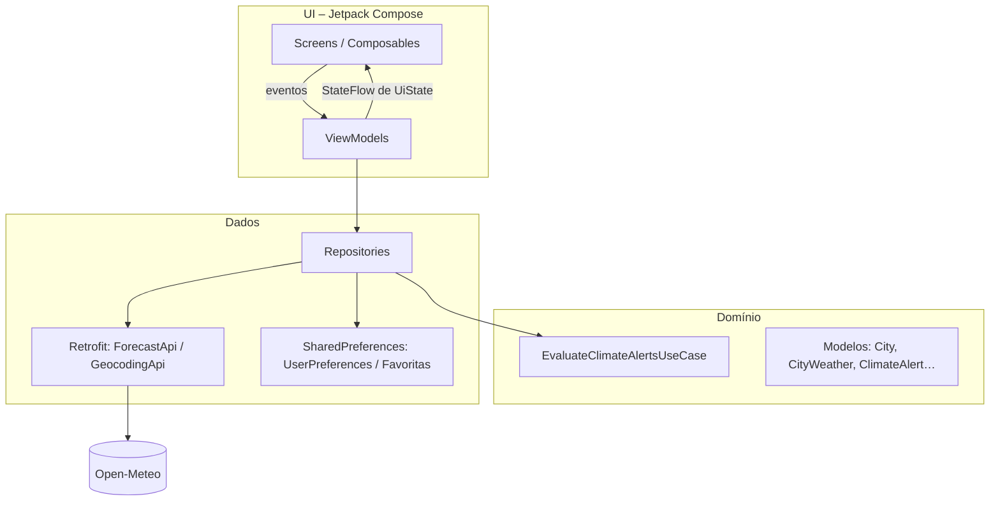

- **UI (Compose)**: as telas apenas exibem o estado e repassam eventos. O estado vem de `StateFlow` coletado com `collectAsStateWithLifecycle()`. Campos de texto usam `mutableStateOf` na ViewModel para responder sem atraso.
- **ViewModels**: carregam dados, aplicam filtros e ordenações e expõem `UiState` (`Idle`, `Loading`, `Success`, `Error`). Nenhuma regra de negócio fica nas telas.
- **Domínio**: modelos puros em Kotlin e o *use case* que transforma previsão em alertas (sem dependência de Android, por isso é fácil de testar).
- **Dados**:
  - `WeatherRepository`: chama a API, aplica as regras de alerta e mantém **cache em memória por 10 min**, para Painel, Alertas e Detalhe não repetirem requisições. Busca várias cidades **em paralelo** (`async/awaitAll`).
  - `CityRepository`: busca cidades e filtra apenas localidades habitadas.
  - `FavoritesRepository`: favoritas persistidas em **SharedPreferences (JSON via Gson)** e expostas como `StateFlow`, de modo que favoritar em uma tela atualiza todas.
  - `UserPreferences`: flag da introdução em **SharedPreferences**.
- **Injeção de dependências manual**: `di/AppContainer` cria as dependências uma única vez, e `ui/AppViewModelProvider` fornece a `ViewModelProvider.Factory` (padrão dos codelabs oficiais).

### Estrutura de pastas

```
app/src/main/java/br/com/fiap/climaalerta
├── ClimaAlertaApplication.kt      # cria o AppContainer
├── MainActivity.kt                # edge-to-edge + tema + ClimaAlertaApp()
├── di/AppContainer.kt             # injeção de dependências manual
├── data
│   ├── local                      # SharedPreferences, cidades padrão, conteúdo das orientações
│   ├── remote
│   │   ├── api                    # interfaces Retrofit (ForecastApi, GeocodingApi)
│   │   ├── dto                    # modelos JSON da API
│   │   ├── mapper                 # DTO -> modelo de domínio
│   │   └── RetrofitFactory.kt
│   └── repository                 # Weather, City, Favorites, SafetyGuide
├── domain
│   ├── model                      # City, CityWeather, ClimateAlert, RiskLevel…
│   └── usecase                    # EvaluateClimateAlertsUseCase (regras de risco)
└── ui
    ├── AppViewModelProvider.kt    # fábrica das ViewModels
    ├── components                 # composables reutilizáveis
    ├── model                      # UiState, formatadores, ícones e cores por domínio
    ├── navigation                 # rotas tipadas, NavHost e barra inferior
    ├── screens                    # splash, onboarding, home, search, detail, alerts, guide
    └── theme                      # cores, tipografia e dimensões
```

### Composables reutilizáveis (`ui/components`)

`ClimaTopAppBar`, `CityWeatherCard`, `CityListItem`, `AlertCard`, `CurrentWeatherCard`, `DailyForecastCard`, `MetricItem`, `RiskBadge`, `CircleIcon`, `WeatherIconBadge`, `FavoriteIconButton`, `SearchTextField`, `SelectableChipRow` (genérico), `SectionTitle`, `PageIndicator`, `MessageView`, `LoadingView` e `ErrorView`.
Exemplo de reutilização: `AlertCard` aparece no Detalhe e na central de Alertas, e `SearchTextField` + `SelectableChipRow` aparecem no Painel e em Alertas.

### Tecnologias

| Categoria | Tecnologia |
|-----------|-----------|
| Linguagem | Kotlin 2.2 |
| UI | Jetpack Compose (BOM 2026.02.01), Material 3, Material Icons Extended |
| Navegação | Navigation Compose 2.9 com rotas tipadas (kotlinx.serialization) |
| Arquitetura | ViewModel, StateFlow, Coroutines, Lifecycle Compose |
| Rede | Retrofit 2.11, Gson Converter, OkHttp Logging Interceptor |
| Persistência local | SharedPreferences |
| Testes | JUnit 4 (regras de alerta e normalização da busca) |
| Build | Android Gradle Plugin 9.2, Gradle 9.4, minSdk 26, targetSdk 36 |

---

## ▶️ Como executar

1. Abra a pasta do projeto no **Android Studio** (versão recente, com Android SDK 36).
2. Aguarde a sincronização do Gradle.
3. Execute em um emulador ou dispositivo com **Android 8.0+** e acesso à internet.

Pela linha de comando:

```bash
./gradlew assembleDebug        # gera app/build/outputs/apk/debug/app-debug.apk
./gradlew testDebugUnitTest    # executa os testes unitários
```

> Dica para a avaliação: para ver a Introdução novamente depois de marcar *"Não mostrar"*, ative **Orientações → Preferências → Exibir introdução ao abrir o app**.

---

## 🔗 Repositório

🔗 https://github.com/miguelfran/ClimaAlerta

## 👨‍💻 Desenvolvedor

| Nome | RM |
|------|----|
| Miguel Franquilino Castro Leite | RM98590 |
